<p align="center">
  
</p>

# Programmatic Advertising CTR Prediction Platform

An end-to-end machine learning system that predicts the probability a user
clicks an ad **before it's shown** — the core scoring function inside a
Demand-Side Platform's real-time bidding engine. Built phase by phase, from
business framing through a production-shaped ETL/feature/modeling pipeline,
on a fully synthetic but statistically realistic 1M-impression dataset.

**Stack:** Python, Pandas/NumPy, PostgreSQL, Scikit-learn, XGBoost, LightGBM,
CatBoost, SHAP, Matplotlib/Seaborn, Jupyter.

---

## Why this project

Click-through rate (CTR) prediction is the highest-leverage ML problem in
programmatic advertising: `expected_value ≈ predicted_CTR × bid_value`, so
the model's output directly sets how much a Demand-Side Platform (DSP) bids
on every ad impression, in real time, at massive scale. It's also a
genuinely hard ML problem — ~2% positive class, high-cardinality
categoricals, temporal drift, and a hard latency budget — which makes it a
good demonstration of production ML judgment, not just model-fitting.

## Architecture

```
Synthetic data (6 CSVs, 1M impressions)
        │
        ▼
PostgreSQL  (6 tables, FK constraints, indexed for analysis queries)
        │
        ▼
ETL pipeline  (extract → validate [18 checks] → clean → label → time-split)
        │
        ▼
Feature engineering  (84 features: leakage-safe expanding-window historical
                       CTR, frequency/target encoding, interactions, time)
        │
        ▼
Model comparison  (Logistic Regression, Random Forest, XGBoost, LightGBM,
                    CatBoost — tuned, cross-validated, SHAP-explained)
        │
        ▼
Selected model  (CatBoost — chosen by validation ROC-AUC, confirmed on test)
```

Per-stage design rationale lives in the docs committed with the code:
`src/etl/README.md` (stage-by-stage pipeline and its fail-loudly policy),
`notebooks/FEATURE_MANIFEST.md` (every feature and how it stays leakage-safe)
and `notebooks/MODELING_README.md` (model choices, tuning, and the LightGBM
early-stopping bug); this README summarizes outcomes.

## Dataset

Synthetic but **not random** — every click is sampled from a logistic model
whose inputs are device, creative type, ad position, time-of-day, weekend
effect, user-interest/campaign-category match, campaign objective, a latent
per-user propensity, and same-day fatigue. That's what gives the downstream
EDA and modeling phases real, recoverable signal instead of noise.

| Table | Rows |
|---|---|
| `users.csv` | 50,000 |
| `advertisers.csv` | 200 |
| `campaigns.csv` | 599 |
| `creatives.csv` | 1,484 |
| `impressions.csv` | 1,000,000 |
| `clicks.csv` | 22,747 (2.27% CTR) |

## Database

PostgreSQL schema with PK/FK constraints and CHECK constraints across all 6
tables (`sql/schema.sql`), loaded via `COPY` in ~56s. FK enforcement was
verified live — a bad `campaign_id` insert is rejected, not silently
accepted. Ten analysis queries (`sql/ctr_analysis_queries.sql`) cover CTR by
campaign/country/device/browser/hour, a 7-day moving average (window
function), a device × creative_type cross-tab (`GROUPING SETS`), and a
per-advertiser campaign ranking (`RANK() OVER (PARTITION BY ...)`).

## ETL pipeline

`src/etl/` — modular extract/validate/clean/transform stages with logging
and config files. 18 automated checks (6 primary-key uniqueness, 6 not-null,
3 referential integrity, 2 value-range, 1 overall-CTR sanity bound) halt the
pipeline on failure rather than passing bad data downstream. The
train/val/test split is **chronological**, not random — train Oct 1–Nov 30
(660,123 rows), validate through Dec 14 (164,223), test Dec 15–30 (175,654) —
to avoid leaking a campaign's own future performance into features computed
from its past. Covered by 6 unit tests (`tests/test_etl.py`).

## EDA

`notebooks/eda.ipynb` — 10 charts covering class imbalance, device/
browser/country/hour CTR patterns, campaign-level CTR spread, user behavior
and same-day fatigue, feature correlations, and the daily CTR trend. Every
chart closes with a written insight tying back to a specific feature
engineering decision.

## Feature engineering

`notebooks/feature_engineering.ipynb` — **84 total features** (17 base +
67 engineered) across time, historical CTR (9 entities, expanding-window),
user activity/recency, campaign daily rolling stats, frequency encoding,
static target encoding, and interactions. Two leakage-safe techniques are
used throughout and explicitly unit-tested with a hand-built toy example:
expanding-window-excluding-current for time-ordered entities, and
fit-on-train/transform-on-all for static categories. Max correlation of any
feature with the label: **0.036** — real signal, no leakage red flag. Full
rationale per feature group in `notebooks/FEATURE_MANIFEST.md`.

## Modeling and results

`notebooks/modeling.ipynb` — trains and compares all 5 candidate models,
with hyperparameter tuning, time-series cross-validation, and SHAP analysis
demonstrated in depth on LightGBM (the fastest model to iterate on in a
single-core environment). **Final model selection is programmatic**, picked
by actual validation ROC-AUC among the three strongest candidates rather
than by assumption:

| Model | Val ROC-AUC | Val PR-AUC |
|---|---|---|
| **CatBoost — selected** | **0.6066** | 0.0335 |
| Logistic Regression | 0.6034 | 0.0336 |
| LightGBM (tuned) | 0.5948 | 0.0320 |
| XGBoost | 0.5801 | 0.0287 |
| Random Forest | 0.5701 | 0.0276 |
| Baseline (constant CTR) | 0.5000 | 0.0220 |

Test-set ROC-AUC: **0.6060** (matches validation — no overfitting gap).
Top-decile lift over baseline: **1.81x**. Calibration checked by
predicted-probability decile (not assumed), since a DSP multiplies this
probability directly into a bid price.

**A real bug was found and fixed along the way**, not glossed over:
LightGBM's early stopping was silently tracking `binary_logloss` instead of
ROC-AUC (`eval_metric` in `.fit()` appends to LightGBM's default rather than
replacing it), which combined with `scale_pos_weight` cut training off after
a single boosting round while validation AUC kept improving for ~40 more.
Caught by logging both metrics verbosely and watching them diverge — fixed
with `metric="auc"` in the constructor + `first_metric_only=True` on the
early-stopping callback. Full account in `notebooks/MODELING_README.md`.

## Tableau revenue dashboard

The model's revenue impact, visualised in Tableau Public: **[Ad Targeting - Revenue Impact Overview](https://public.tableau.com/app/profile/isfaque.ansari5273/viz/Ad_Targeting_Revenue_Impact/AdTargeting-RevenueImpactOverview)**

Built from the executed notebook outputs (Part 1 commits no raw CSVs): test-set deciles, the model comparison, and device/country segment CTR. Headline reads from the dashboard:

- Top decile (D10) actual CTR **4.16% = 1.81x** the 2.29% test baseline; the bottom decile runs at 1.10%
- Ranked targeting simulation: the top 30% of impressions by model score capture **43.9%** of clicks
- Calibration is shown honestly on the dashboard: predicted probabilities (31.7%-59.5% by decile) are **not** calibrated against actual CTR (1.1%-4.2%), so revenue is computed from actual decile CTR, never from raw probabilities - Platt/isotonic recalibration is the stated next step

The workbook is committed at `dashboards/Ad_Targeting_Revenue_Impact.twbx` (7
sheets, with its underlying data embedded as `CTR.hyper`). Its source CSVs are
not published separately - every figure above is readable in
`notebooks/modeling.ipynb`'s calibration and lift cells. Part 2's equivalent
datasets *are* committed, as plain CSVs in `ancillary/tableau/`.

## Part 2 - Ancillary purchase prediction (`ancillary/`)

The second half of this project: the same propensity method applied to travel ancillaries. Predicts, at checkout and before the offer is shown, whether a flight booking buys travel insurance, a seat upgrade, or extra baggage - then simulates which targeting depth earns the most revenue per offer spent.

- **Logistic Regression selected** over Random Forest (validation ROC-AUC 0.6515 vs 0.6501; test 0.6565) on 60,000 bookings (synthetic, documented propensity model - disclosed in `ancillary/README.md`)
- Take rate 38.71%; top decile 65.57% (**1.61x lift**); top 30% of bookings hold **52.65%** of ancillary revenue
- Probabilities verified calibrated (unlike Part 1): top score bin predicted 0.662 vs actual 0.656
- SQL data prep with a leakage-audited customer history, chronological train/validation/test split, 6 data-integrity tests

## Limitations

- **Synthetic data**: several real-world CTR drivers (creative fatigue over
  weeks, cross-device identity, seasonality, adversarial bidding dynamics)
  aren't present to be learned. The reported ROC-AUC is a property of this
  generative model's noise level, not a claim about real-world CTR
  predictability.
- **~0.60 ROC-AUC ceiling**: traced to a per-user latent propensity in the
  data-generating process that's only partially recoverable through
  historical-CTR proxies — a structural property of the feature set, not an
  undertuned model (confirmed: XGBoost and LightGBM both independently
  plateau in the same ~40-round training window).
- **SHAP was computed on LightGBM, not the selected CatBoost model** — the
  two only overlap on 4 of their top 15 features, so the SHAP analysis is
  best read as general interpretability signal for this feature set, not a
  precise account of CatBoost's own decisions.
- **Single-core, ~4GB training environment**: models were trained on a
  100,000-row stratified sample rather than the full 660K-row training set.
  The pipeline is otherwise unchanged and scales linearly on normal
  multi-core hardware.

## Future improvements

- Compute SHAP directly against CatBoost via a `Pool` object with declared
  categorical features, rather than using LightGBM as an interpretability
  proxy.
- Wrap hyperparameter tuning in Optuna/Ray Tune with a proper multi-fold
  time-series CV objective instead of single-split validation scoring.
- Add a real-time feature store (Redis/Feast) and a `<10ms` scoring service
  behind the trained model to complete the online-serving half of the
  architecture, which this project implements conceptually but not
  as a live endpoint.
- Retrain on the full 3M-impression scale (`n_impressions` in
  `config/data_gen_config.yaml`) on multi-core hardware to check whether the
  ~0.60 ROC-AUC ceiling is a sample-size artifact or genuinely structural.

## Repository structure

```
Programmatic-Advertising-CTR-Prediction-Pipeline/
├── config/               # data_gen_config.yaml, etl_config.yaml
├── notebooks/            # eda.ipynb, feature_engineering.ipynb, modeling.ipynb
│                         # + FEATURE_MANIFEST.md, MODELING_README.md, figures/
├── sql/                  # schema.sql, ctr_analysis_queries.sql
├── src/
│   ├── database/         # PostgreSQL loader (COPY, 6 tables, FK-verified)
│   ├── etl/              # extract / validate / clean / transform + stage README
│   └── utils/            # logging, config
├── tests/                # 6 ETL unit tests
├── logs/                 # pipeline.log - the executed ETL run, start to finish
├── dashboards/           # Ad_Targeting_Revenue_Impact.twbx (Part 1, data embedded)
├── ancillary/            # Part 2 - self-contained sub-project, its data IS committed
├── pipeline_banner.svg
├── requirements.txt
└── README.md
```

**What isn't committed, stated plainly:** Part 1's `data/raw/` CSVs, the
`data/processed/` parquet and `best_model.joblib` artifacts, and the Phase-3
generator that produced those CSVs all stay outside this repo — only its
`config/data_gen_config.yaml` is here. So Phases 4-8 are readable and
reviewable but not runnable from a fresh clone. Every Part 1 number in this
README is still independently checkable, because the executed notebook outputs
and `logs/pipeline.log` are committed. Part 2 has no such gap: its generator,
data, SQL, notebook, reports and tests are all in `ancillary/`.

## Running it

```bash
pip install -r requirements.txt --break-system-packages

# Part 1 — needs your own data/raw/*.csv (not committed); Postgres optional
python -m src.database.load_to_postgres     # Phase 4: applies sql/schema.sql, COPYs 6 CSVs
python -m src.etl.run_etl                   # Phase 5: reads Postgres, falls back to CSV
python -m pytest tests/test_etl.py -v

# Phases 6-8 — read ../data/processed/*.parquet written by Phase 5; run in order
jupyter notebook notebooks/eda.ipynb
jupyter notebook notebooks/feature_engineering.ipynb
jupyter notebook notebooks/modeling.ipynb

# Part 2 — self-contained, runs end to end from a fresh clone
cd ancillary
pip install -r requirements.txt
python -m src.generate_data                 # regenerates data/ byte-exactly (seed 42)
pytest tests/ -q                            # 6 data-integrity tests
jupyter notebook notebooks/ancillary_propensity_model.ipynb
```
